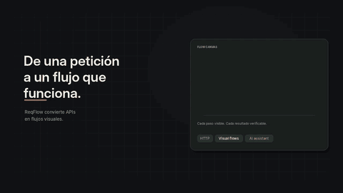

# ReqFlow AI

Aplicación nativa de escritorio **C++20 + Qt 6**, local-first, para crear y enviar peticiones HTTP sin escribir código. Esta es una base de producto en desarrollo, no la plataforma completa del prompt maestro.

## Motion graphics

### Parte 1 — Presentación de ReqFlow AI



[Ver o descargar MP4 — Parte 1](https://github.com/CRISTOP-bot/ReqFlowAI/blob/main/videos/reqflow-ai-motion-part-1.mp4) · 12 s · 1280 × 720 · H.264 · 24 FPS.

### Parte 2 — De una instrucción a un flujo API


[Ver o descargar MP4 — Parte 2](https://github.com/CRISTOP-bot/ReqFlowAI/blob/main/videos/reqflow-ai-motion-part-2.mp4) · 10 s · 1280 × 720 · H.264 · 24 FPS · sin audio.

Los GIF son vistas previas animadas para que se reproduzcan directamente en GitHub; los MP4 enlazados son las versiones completas.

---

## Documentación para desarrolladores

Consulta el [índice de documentación](docs/INDEX.md), la [arquitectura](docs/ARCHITECTURE.md), las [funciones y su estado](docs/FEATURES.md), el [modelo de datos](docs/DATA_MODEL.md), la [guía de seguridad](docs/SECURITY.md), el [informe de auditoría de seguridad 2026-10-26](docs/SECURITY_AUDIT.md) y las [instrucciones de desarrollo y pruebas](docs/DEVELOPMENT.md). Las reglas de contribución están en [AGENT.md](AGENT.md) y exigen documentar **todo** cambio antes de darlo por terminado.

## Licencia

ReqFlow AI se distribuye bajo la licencia [Apache License 2.0](LICENSE). El código Rust declara `Apache-2.0`; las dependencias mantienen sus licencias propias, que deben revisarse en sus avisos de distribución.

## Estado real

### Beta experimental (en desarrollo)

- **Comparador de respuestas JSON del historial**: selecciona dos ejecuciones guardadas y compara los cuerpos JSON localmente, mostrando rutas con cambios añadidos, eliminados o modificados; también enseña estado HTTP y duración de cada ejecución. No hace solicitudes de red. La comparación solo entiende JSON y no compara cuerpos de texto/XML ni esquemas OpenAPI; está limitada a 2000 cambios y 48 niveles, y depende de los cuerpos que el historial haya conservado tras su redacción segura. Las rutas distinguen claves simples (`$.user.name`) de claves especiales (`$['user.name']`) y escapan comillas y barras invertidas. Los arreglos se comparan por índice. Integrado en el historial como «Comparar seleccionadas · BETA»; requiere seleccionar exactamente dos filas. Hay pruebas Qt Test para cambios, límites y claves especiales, incluidas en la suite local de 24 pruebas que pasó íntegra con Qt 6.12.

### Implementado en C++/Qt

- **Backend Rust parcial (integración inicial, compilada y probada en esta entrega)**: la expansión estricta de variables `{{identificador}}` ya delega en una crate Rust (`backend/`) enlazada como biblioteca estática a través de FFI C; la interfaz Qt existente se conserva. La validación JSON y la conversión de valores viven en Rust, con pruebas unitarias Cargo (6 pruebas, pasadas con rustc/cargo 1.99.1). Persistencia SQLite, red HTTP, flujos y el resto de servicios siguen en C++/Qt; esto no es una migración completa del backend. Cargo/Rust estable es requisito adicional para compilar esta rama.
- **Login local de aplicación (compilado y con pruebas de almacenamiento ejecutadas; la interacción visual sigue sin QA manual)**: en el primer inicio se solicita crear usuario y contraseña; cada apertura posterior valida ambos antes de mostrar la ventana principal. La contraseña se almacena como verificador PBKDF2-HMAC-SHA-256 (Qt 6 `QPasswordDigestor`), sal aleatoria individual de 16 bytes, 600 000 iteraciones y comparación en tiempo constante. Usuario normalizado NFKC/casefold, contraseña de 12–1024 caracteres, confirmación en el alta; cancelar cierra la aplicación sin dejar la ventana principal visible. Es una puerta local de interfaz, no una cuenta web, SSO ni autenticación remota. La lógica de alta/login/persistencia está cubierta por pruebas Qt Test ejecutadas en local; el flujo interactivo del diálogo no está automatizado.
- **Importante sobre seguridad/recuperación**: la cuenta no cifra la base SQLite ni protege ante quien copie/edite el archivo o tenga acceso al sistema operativo mientras la sesión está abierta. No hay recuperación remota ni alta secundaria ni restablecimiento que borre datos; si olvidas la contraseña, los datos existentes no se recuperan mediante ReqFlow AI. Conserva tu contraseña en un gestor seguro y haz copias de seguridad protegidas.
- Ventana Qt Widgets con editor de peticiones, proyectos y respuesta.
- Cliente de red basado en `QNetworkAccessManager`: GET, POST, PUT, PATCH, DELETE, HEAD y OPTIONS; cabeceras, parámetros, cuerpo, timeout y cancelación de respuestas activas en la capa de red.
- SQLite mediante Qt SQL: proyectos, peticiones guardadas, historial; añadir, editar y eliminar petición.
- Entornos locales por proyecto con variables JSON; sustitución estricta `{{nombre}}` en URL, parámetros, cabeceras y cuerpo antes de enviar. Variables desconocidas o marcadores mal formados bloquean el envío; las plantillas guardadas no se modifican. Por ausencia de bóveda, se rechazan nombres de variable que parezcan secretos.
- Response Studio en progreso: cuerpo con formato JSON legible, árbol navegable para respuestas JSON, búsqueda siguiente en el texto del cuerpo y selección de un nodo para localizar su valor en el texto. El árbol limita la vista a 5000 nodos y 64 niveles; no edita la respuesta ni sustituye una vista segura especializada para HTML/XML. El cuerpo se limita a 2 millones de caracteres.
- API Doctor básico en respuesta: hallazgos observables y heurística explícitamente etiquetada.
- Protección conservadora ampliada por la auditoría de seguridad 2026-10-26 (detalle en [docs/SECURITY_AUDIT.md](docs/SECURITY_AUDIT.md)): filtro de secretos unificado en UI, ProjectStore, FlowEngine y FlowEditor (nombres y valores con forma de credencial: Bearer/Basic/sk-/gh_/AKIA/JWT, también en cuerpos form-urlencoded y XML), con redacción por valor en el historial; validación RFC 7230 de cabeceras en la UI y el motor de flujos; respuestas abortadas por encima de 10 MiB; máximo 5 redirecciones, solo al mismo origen salvo confirmación del usuario (diálogo al cruzar origen) y confirmación previa antes de ejecutar un flujo listando sus destinos; presupuesto de 100 000 nodos YAML y tope de 20 MiB al importar especificaciones; URLs con esquema distinto de http/https rechazadas al persistir; en Unix la base SQLite se crea en 0600 (umask 0077 + chmod) y el directorio por defecto en 0700. Sigue sin bóveda de secretos: todo esto es heurística y control de acceso, no cifrado.
- Editor visual Qt de flujos conectado a la aplicación: canvas con nodos movibles, selección, conexiones por origen/destino y rama true/false, configuración JSON, validación, ejecución y persistencia local. El motor permite inicio, petición HTTP, extracción JSON por ruta, transformación, condición y resultado; limita pasos y registra ejecuciones. Aún no hay repetición/esperas, minimapa, control de cancelación desde la UI ni editor de propiedades basado en formularios.
- Importador local de un subconjunto de OpenAPI 3.x en JSON y YAML, para operaciones HTTP, query params, encabezados y ejemplo sencillo de cuerpo `application/json`; muestra advertencias y pide confirmación antes de guardar. Resuelve únicamente referencias locales de un nivel para Path Items y operaciones bajo `#/components/...`; no resuelve referencias externas, transitivas/anidadas ni OAuth/security schemes, y no cubre todos los esquemas.
- SQLite filtra en la propia capa de almacenamiento URL con userinfo/parámetros sensibles, cabeceras/campos JSON con nombre sensible, URLs del historial, cabeceras/respuestas JSON y mensajes de error. Las respuestas de texto no JSON se omiten del historial. Es redacción heurística, no una bóveda.
- Suites de aserciones API locales: `status`, `header`, `json_value`, `json_type` por ruta y `duration_ms`; las comparaciones aceptan `equals`, `not_equals`, `contains` y límites de duración. Definiciones y ejecuciones se guardan en SQLite. La UI exige confirmación explícita antes de enviar la petición guardada asociada. Aún no hay explorador de resultados históricos de suites ni editor visual de aserciones: definición por JSON. Ejemplo: `[ {"name":"OK","type":"status","expected":"200"}, {"type":"json_value","path":"$.data.id","expected":"7"} ]`.
- Un ejecutable de pruebas Qt Test está registrado en CMake con casos para cabeceras, bloqueo de peticiones inválidas en flujos, OpenAPI JSON/YAML y refs locales/no resolubles, aserciones, persistencia, rechazo heurístico de secretos y las 8 pruebas nuevas de la auditoría de seguridad. La suite completa (24 pruebas) se ejecutó en local con Qt 6.12 y pasó íntegra; la CI Linux debe confirmarlo tras el commit. Los tests de login cubren la lógica de almacenamiento, pero no la interacción visual.
- Timeout HTTP ahora marca explícitamente las solicitudes abortadas por límite y el motor de flujos reporta el caso de terminal sin resultado en vez de considerarlo éxito.

### Todavía pendiente

Quedan fuera: nodos de espera/reintento/loop, exportación/versionado formal de flujos, extracción visual, árbol JSON/búsqueda/resaltado, diff de respuestas y especificaciones, OpenAPI security schemes, referencias `$ref` externas/transitivas, agente IA con conversaciones persistentes y proveedores, API Doctor completo, mock server/replay, plugin API, sincronización real, Keychain/Secret Service/Credential Manager y Security Lab completo con auditoría de alcance. La sustitución de entornos es literal, no una bóveda ni secret manager. La UI de suites usa JSON, no un constructor visual, y aún no expone el historial de ejecuciones. No se afirma que estas funciones estén implementadas.

## Android (port experimental ARM64)

Hay un APK Android arm64-v8a construido por CI para pruebas. La [última compilación y verificación](https://github.com/CRISTOP-bot/ReqFlowAI/actions/runs/40263775013) en `dev` terminó correctamente; descarga `reqflow-ai-android-arm64-v8a` desde la sección **Artifacts** del run. Es una compilación Qt/C++ que conserva el backend Rust y la importación YAML. El APK no está firmado para distribución, y no se ha instalado ni probado en un teléfono o emulador; la interfaz táctil y el selector de archivos Android siguen pendientes de QA. No es una release estable ni está publicado en Play Store.

## Requisitos

- C++20.
- CMake 3.21 o posterior.
- Qt 6.4 o posterior: Core, Widgets, Network, Sql y Test.
- Driver QSQLITE habilitado en el paquete de Qt.
- Rust estable/Cargo, acceso a crates.io para `serde_json`, y `yaml-cpp` para OpenAPI YAML.

## Compilar y ejecutar

```sh
cmake -S . -B build -DCMAKE_BUILD_TYPE=Release
cmake --build build --parallel
./build/reqflow-ai
```

Pruebas:

```sh
cmake -S . -B build -DBUILD_TESTING=ON
cmake --build build --parallel
ctest --test-dir build --output-on-failure
```

Datos locales en `~/.local/share/reqflow-ai/reqflow.sqlite3`.

## Verificación de esta entrega

En esta entrega (2026-10-26) se ejecutó la validación completa en local sobre **Fedora (GNOME), Qt 6.12.0, gcc 16.2.1, CMake, yaml-cpp 0.9.0, rustc/cargo 1.99.1** (Rust instalado con rustup en `~/.cargo`; hay que tener `~/.cargo/bin` en el PATH para que CMake encuentre `cargo`):

```sh
cmake -S . -B build -DBUILD_TESTING=ON        # configuración correcta
cmake --build build --parallel                # app + tests enlazan sin errores
ctest --test-dir build --output-on-failure    # 1/1 Passed (reqflow-core-tests, 17.21 s)
./build/reqflow-core-tests                    # Totals: 24 passed, 0 failed (17 638 ms)
cargo test --manifest-path backend/Cargo.toml # 6 passed; 0 failed

cmake -S . -B build-release -DCMAKE_BUILD_TYPE=Release -DBUILD_TESTING=ON
cmake --build build-release --parallel         # [100%] Built target reqflow-ai
ctest --test-dir build-release --output-on-failure  # 1/1 Passed (17.02 s)
```

Las 24 pruebas Qt Test incluyen las 8 nuevas de la auditoría de seguridad (esquemas de URL, filtro unificado de secretos, historial redactado por valor y acotado, YAML bomb, tope de 10 MiB, redirecciones mismo/cross-origin, cabeceras RFC 7230 y permisos 0600 de la base). También se reparó la incompatibilidad del `moc` de Qt 6.12 con los raw strings del propio fichero de tests, que rompía el build de CI (run 40263774958). Pendiente: verificar que los workflows en GitHub Actions terminan en verde tras el commit, y la prueba interactiva manual de la aplicación (login, envío real contra un servidor externo y diálogos de redirección) no está automatizada.

## Uso seguro

Enviar una petición puede modificar un servidor. Verifica destino, método y contenido, y usa solo APIs que tengas autorización para probar. Sin bóveda del sistema operativo disponible, la interfaz bloquea guardar/enviar peticiones con nombres de campos que parecen secretos; esto es un filtro conservador, no un gestor de credenciales ni una garantía de detección. No guardes tokens en texto libre. La aplicación es offline salvo las peticiones HTTP que el usuario envíe.

## Sitio web

El sitio del proyecto se publica en [ReqFlow AI](https://cristop-bot.github.io/ReqFlowAI/). La web se divide en páginas independientes: [inicio](https://cristop-bot.github.io/ReqFlowAI/), [funciones](https://cristop-bot.github.io/ReqFlowAI/funciones.html), [descargas](https://cristop-bot.github.io/ReqFlowAI/descargas.html), [proyecto](https://cristop-bot.github.io/ReqFlowAI/proyecto.html), [documentación](https://cristop-bot.github.io/ReqFlowAI/documentacion.html), [validación](https://cristop-bot.github.io/ReqFlowAI/validacion.html) y [multimedia](https://cristop-bot.github.io/ReqFlowAI/multimedia.html). El HTML está separado de `website/assets/site.css` y `website/assets/reveal.js`. GitHub Pages despliega los archivos del directorio `website/` desde la rama `dev`. La página multimedia enlaza GIF y MP4 ya presentes en `videos/`; esos motion graphics son material visual, no evidencia de una función ejecutable. La descarga del producto ofrece únicamente código fuente mientras no haya un binario Linux verificado.
